## Overview

Simple java swing GUI for [yt-dlp](https://github.com/yt-dlp/yt-dlp). lets you download only part of the video

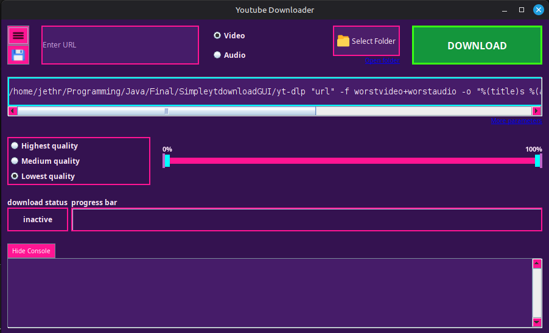

**[⬇️ Download the latest release](https://github.com/jethrothelion/Samplers-ytdlp-GUI/releases/latest)**

## Getting Started

Download the release for your specified version and run the installer file

The Windows and Linux installers include everything you need: yt-dlp, ffmpeg and Java are all bundled.

The jar is universal and small file size but doesnt include ffmpeg, yt-dlp or java 

After you paste a link, give it a second. The app fetches the video's duration before the timeline updates.

installs to program files on windows or opt on linux

## Features
- **Download just the part you want.** The timeline shows the section you've selected, and only that section gets downloaded.
- **Timeline zoom.** Hold a handle still for a second to zoom in 10x for precise cuts.
- **Fully editable command line.** Any argument yt-dlp supports can be used in the GUI, and there's a link to yt-dlp's argument list for easy access.
- **Simple buttons** for the most common options, such as audio or video and quality.
- **Custom flags.** Set your own yt-dlp arguments in Settings, and they're added to every download.
- **Cookies support** for age-restricted and members-only videos. Pick a `cookies.txt` file, or type a browser name like `chrome`.
- **Thumbnails and metadata** are embedded in every download automatically.
- **Saved settings.** Your audio/video choice, quality, console visibility and (optionally) window size are remembered between sessions.
- **Update yt-dlp from inside the app** when it goes stale.

  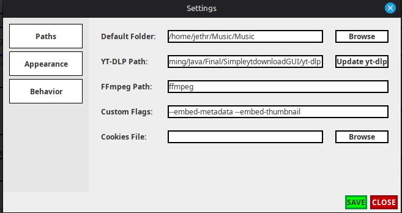
  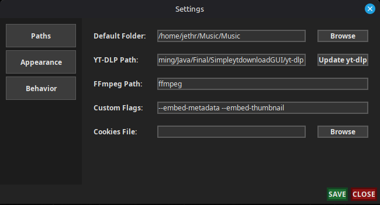

## THEMES!! 

Pick a theme in Settings. Nine are included:

<b>🎨 View all themes</b>

 

<table>
  <tr>
    <td align="center">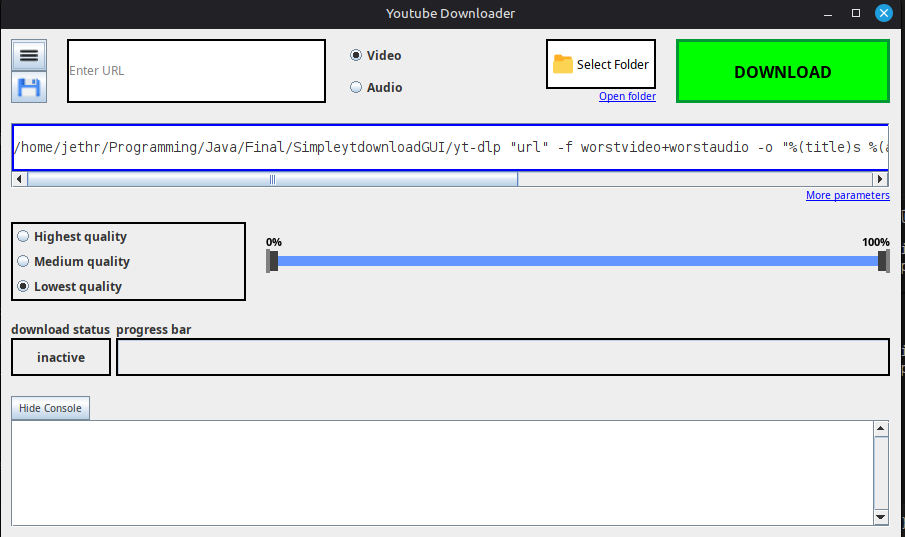 <b>Light</b></td>
    <td align="center">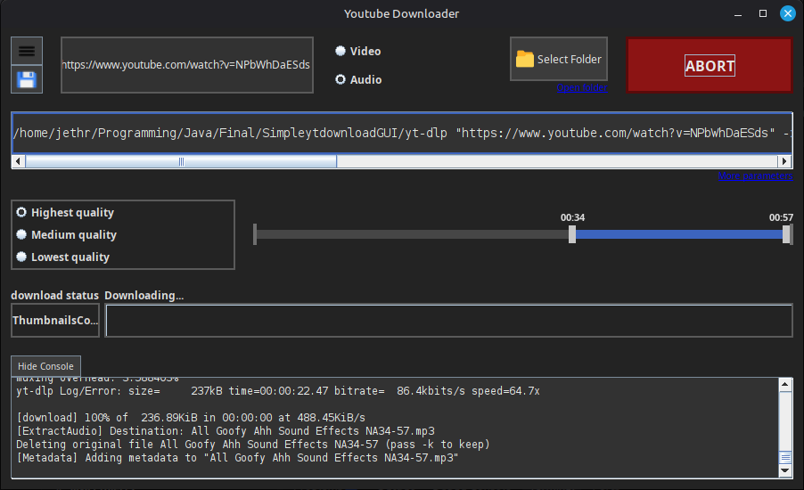 <b>Dark</b></td>
    <td align="center">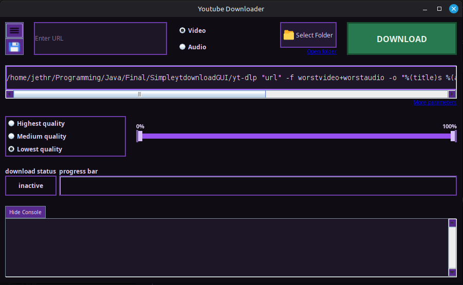 <b>Midnight</b></td>
  </tr>
  <tr>
    <td align="center">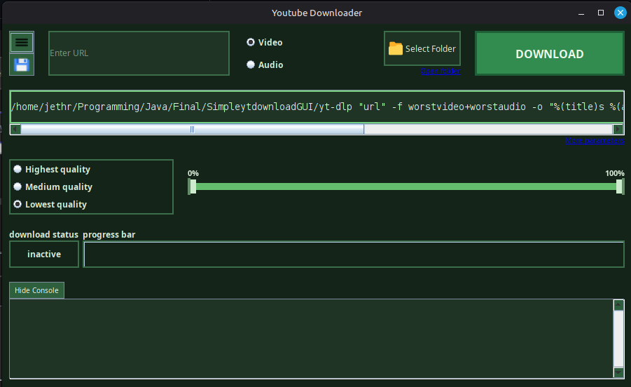 <b>Forest</b></td>
    <td align="center">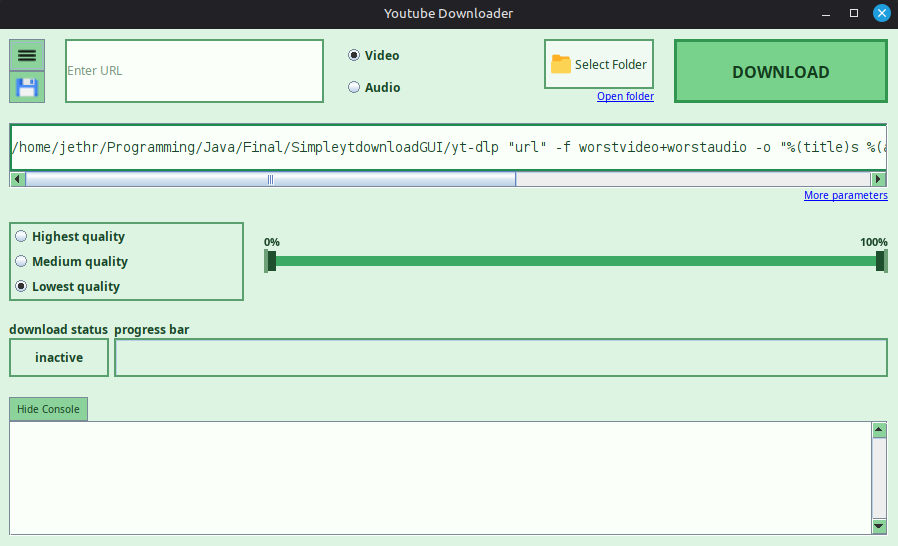 <b>Mint</b></td>
    <td align="center">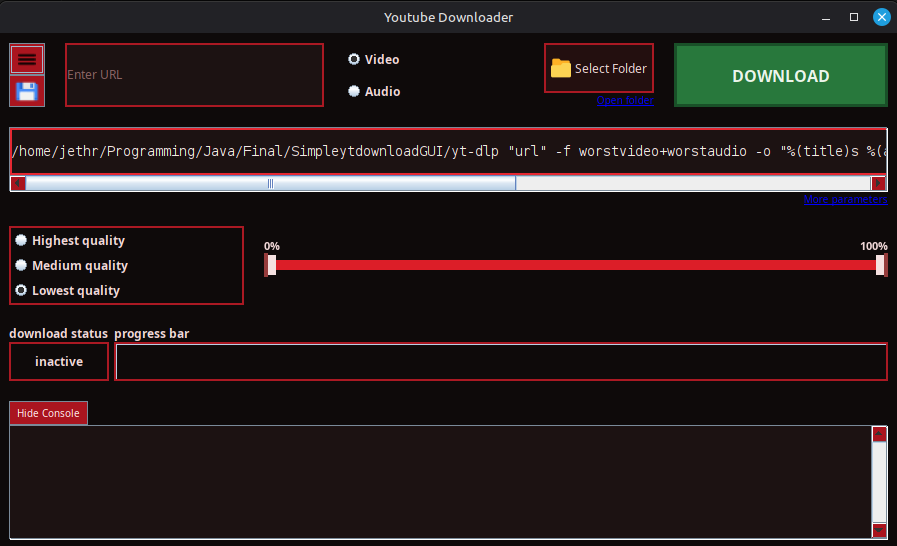 <b>Crimson</b></td>
  </tr>
  <tr>
    <td align="center">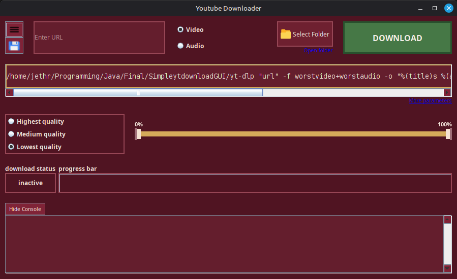 <b>Burgundy</b></td>
    <td align="center"> <b>Pink</b></td>
    <td align="center">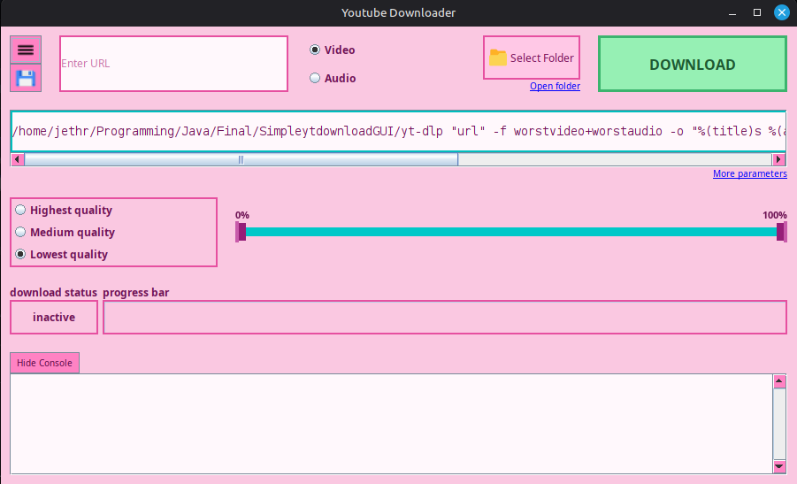 <b>Bubblegum</b></td>
  </tr>
</table>

### Make your own theme

Themes are plain text files in the `themes` folder. The first line is the name shown in Settings, and each line after that sets a color as `name=r,g,b` (or `name=r,g,b,a` for transparency). To make your own, copy an existing theme such as `dark.theme`, change the colors, and save it with a new name. It will show up in the Settings dropdown.

## Troubleshooting

**Downloads suddenly fail:** sites like YouTube change often, so update yt-dlp first (Settings → Update yt-dlp).

**The update fails with a permission error:** on Windows, run the app as administrator and try again. On Linux or macOS, run the `sudo` command the app shows you.

**yt-dlp was installed with pip, apt or brew:** it can't update itself, so update it with the tool you installed it with.

**Something else went wrong:** run the app from a terminal. It prints more detailed debugging information there. If you're still stuck, [open an issue and id love to try to help :)](https://github.com/jethrothelion/Samplers-ytdlp-GUI/issues).

## Running from Source

Requirements: I used Java 25+, with [yt-dlp](https://github.com/yt-dlp/yt-dlp) and [ffmpeg](https://ffmpeg.org) on your PATH or in the project folder.

For icons too show they must be coppied into the folder where your classes are

Run it from the project folder so the app can find the `themes` folder.

## Credits

Yt-DLP-GUI is built on:

- **[yt-dlp](https://github.com/yt-dlp/yt-dlp)**, which does all the downloading
- **[FFmpeg](https://ffmpeg.org)**, used for trimming, merging, converting and embedding thumbnails

This project is not affiliated with or endorsed by either of them. Licenses for all bundled software are listed in [THIRD_PARTY_NOTICES.txt](THIRD_PARTY_NOTICES.txt).

## License

Licensed under the GNU General Public License v3.0. See [LICENSE](LICENSE).

